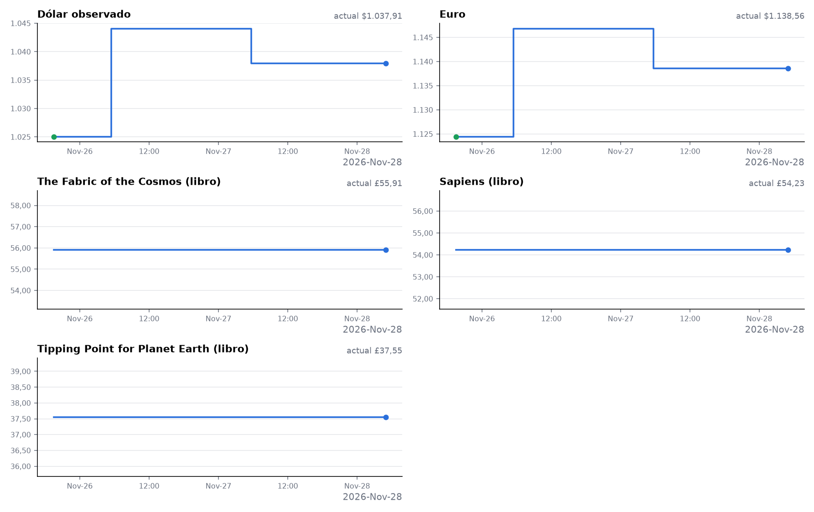
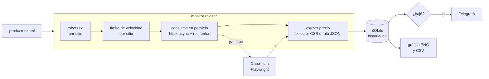

# monitor-precios

[](https://github.com/sebakine/monitor-precios/actions/workflows/ci.yml)
[](https://github.com/sebakine/monitor-precios/actions/workflows/monitor.yml)


Monitor de precios asíncrono. Consulta tiendas y APIs **en paralelo** con `asyncio` y `httpx`,
guarda el historial en **SQLite** y avisa por **Telegram** cuando un precio baja de un umbral o cae
un porcentaje. Corre solo cada 6 horas en GitHub Actions y publica el historial en la rama
[`datos`](https://github.com/sebakine/monitor-precios/tree/datos).

## Historial en vivo

Este gráfico lo regenera el workflow [Monitor de precios](https://github.com/sebakine/monitor-precios/actions/workflows/monitor.yml)
en cada corrida (horas de Chile):



Los datos completos están en [`precios.csv`](https://github.com/sebakine/monitor-precios/blob/datos/precios.csv).
Los libros vienen de [books.toscrape.com](https://books.toscrape.com), una tienda hecha para
practicar scraping cuyos precios no cambian; el dólar y el euro vienen de la API pública
[mindicador.cl](https://mindicador.cl) y sí cambian cada día hábil.

## Cómo funciona



1. Lee los productos de `productos.toml`.
2. Antes de consultar un sitio descarga su `robots.txt` (una vez por corrida) y respeta sus reglas
   y su `Crawl-delay`.
3. Consulta todos los productos a la vez, con un tope de concurrencia global y una pausa mínima
   entre consultas al **mismo** sitio. Los errores temporales (red, 429, 5xx) se reintentan con
   espera exponencial.
4. Extrae el precio con un selector CSS (páginas HTML) o una ruta (APIs JSON) y lo interpreta
   en formato chileno o internacional (`$12.990`, `£51.77`, `1.299,90 €`).
5. Compara con el último precio guardado, guarda la consulta y envía las alertas.

Un producto que falla nunca detiene a los demás: su error queda registrado en el historial.

## Inicio rápido

Necesitas [uv](https://docs.astral.sh/uv/) (o pip) y Python 3.11 o superior.

```bash
git clone https://github.com/sebakine/monitor-precios.git
cd monitor-precios
uv sync

uv run monitor validar            # revisa productos.toml sin consultar nada
uv run monitor revisar            # consulta todo una vez y guarda en historial.db
uv run monitor revisar            # la segunda vez muestra la variación
uv run monitor resumen            # actual, mínimo y máximo por producto
uv run monitor historial dolar    # últimos precios de un producto
uv run monitor grafico            # historial.png
uv run monitor exportar           # precios.csv
```

Salida real de una segunda corrida de `monitor revisar` (`=` significa que el precio no cambió):

```text
Revisión de precios
┏━━━━━━━━━━━━━━━━━━━━━━━━━━━━━━━━━━━━━━━━┳━━━━━━━━━━━┳━━━━━━━━━━━┳━━━━━━━━┳━━━━━┓
┃ Producto                               ┃    Precio ┃ Variación ┃ Estado ┃  ms ┃
┡━━━━━━━━━━━━━━━━━━━━━━━━━━━━━━━━━━━━━━━━╇━━━━━━━━━━━╇━━━━━━━━━━━╇━━━━━━━━╇━━━━━┩
│ Sapiens (libro)                        │    £54,23 │         = │ ok     │ 160 │
│ The Fabric of the Cosmos (libro)       │    £55,91 │         = │ ok     │  76 │
│ Tipping Point for Planet Earth (libro) │    £37,55 │         = │ ok     │  72 │
│ Dólar observado                        │ $1.025,06 │         = │ ok     │ 509 │
└────────────────────────────────────────┴───────────┴───────────┴────────┴─────┘
```

## Configuración

Cada producto es una tabla `[[producto]]` en `productos.toml`:

```toml
[ajustes]
concurrencia = 5          # consultas simultáneas en total
espera_por_sitio = 1.0    # segundos entre dos consultas al mismo sitio

[[producto]]
id = "sapiens"
nombre = "Sapiens (libro)"
url = "https://books.toscrape.com/catalogue/sapiens-a-brief-history-of-humankind_996/index.html"
selector = ".product_main .price_color"
moneda = "GBP"
umbral = 50.0             # avisar si baja de £50

[[producto]]
id = "dolar"
url = "https://mindicador.cl/api/dolar"
tipo = "json"
ruta = "serie.0.valor"
baja_pct = 1.5            # avisar si cae 1,5 % o más desde la consulta anterior
```

| Campo | Para qué sirve |
|---|---|
| `id` | Identificador único (minúsculas, números, `-` o `_`). |
| `nombre` | Nombre para tablas, gráficos y alertas. Por defecto, el `id`. |
| `url` | Página o API a consultar. |
| `tipo` | `html` (por defecto) o `json`. |
| `selector` | Selector CSS del precio, para `html`. Si el elemento tiene atributo `content`, se usa ese. |
| `ruta` | Ruta al precio dentro del JSON, separada por puntos: `serie.0.valor`. |
| `moneda` | Código de moneda para mostrar el precio (`CLP` por defecto). |
| `decimal` | `.` o `,` para fijar el separador decimal; sin él se deduce del texto. |
| `js` | `true` si el precio lo pinta JavaScript; usa Chromium con Playwright. |
| `umbral` | Avisar cuando el precio llegue a este valor o baje de él. |
| `baja_pct` | Avisar cuando el precio caiga al menos este porcentaje. |

`[ajustes]` acepta también `timeout` (segundos), `intentos`, `user_agent` y `respetar_robots`.
`monitor validar` lista todos los errores del archivo de una vez.

### Páginas con JavaScript

Algunas tiendas cargan el precio después de abrir la página. Para esas, marca `js = true` e
instala el extra:

```bash
uv sync --extra js
uv run playwright install chromium
```

Se abre un solo Chromium sin interfaz por corrida y se comparte entre todos los productos que lo
necesitan. Para usar un Chrome ya instalado, define `MONITOR_CHROMIUM` con la ruta del ejecutable.

## Alertas por Telegram

1. Habla con [@BotFather](https://t.me/BotFather), crea un bot con `/newbot` y copia el token.
2. Escríbele cualquier cosa a tu bot y abre `https://api.telegram.org/bot<TOKEN>/getUpdates`
   para ver tu `chat.id`.
3. Define las variables y corre el monitor:

```bash
export TELEGRAM_BOT_TOKEN="123456:ABC..."
export TELEGRAM_CHAT_ID="987654321"
uv run monitor revisar
```

En GitHub Actions van como *secrets* del repositorio con esos mismos nombres. Sin ellos, las
alertas se escriben en el log.

El aviso por umbral se envía **al cruzarlo**, no en cada consulta mientras el precio siga abajo:
una oferta que dura una semana genera un solo mensaje. Si Telegram falla, el precio igual queda
guardado y la alerta se informa como no enviada.

## Scraping ético

- **robots.txt**: se respeta siempre por defecto, siguiendo [RFC 9309](https://www.rfc-editor.org/rfc/rfc9309):
  si responde 404 todo está permitido, y si responde 401, 403, un error 5xx o no hay red, no se
  consulta el sitio en esa corrida.
- **Crawl-delay**: si el sitio lo declara y es mayor que `espera_por_sitio`, se usa ese.
- **Ritmo**: una pausa mínima entre consultas al mismo sitio y un tope de consultas simultáneas.
  El monitor corre cada 6 horas, no cada minuto.
- **Identificación**: el `User-Agent` dice qué es y enlaza a este repositorio, para que el dueño
  del sitio sepa quién consulta.
- **Términos de uso**: robots.txt no reemplaza los términos de cada tienda. Antes de agregar un
  sitio, revisa que permita el acceso automatizado. Cuando existe una API pública (como
  mindicador.cl), es mejor usarla.

## Ejecución programada

El workflow [`monitor.yml`](.github/workflows/monitor.yml) corre cada 6 horas (y a mano desde la
pestaña Actions):

1. Trae la rama `datos`, que tiene `historial.db`, `historial.png` y `precios.csv`.
2. Corre `monitor revisar`, regenera el gráfico y el CSV, y escribe un resumen de la corrida.
3. Hace commit en la rama `datos`. Así `main` queda solo con código y el historial queda versionado.

Si falla un producto, la corrida termina en verde con una advertencia; solo falla si no funcionó
ninguna consulta.

## Decisiones de diseño

- **asyncio + httpx** en vez de hilos: las consultas pasan casi todo el tiempo esperando la red,
  y con un solo hilo es fácil controlar la concurrencia por sitio con `asyncio.Lock` y un
  `Semaphore` global. `TaskGroup` (Python 3.11) mantiene el orden y no deja tareas sueltas.
- **SQLite** de la biblioteca estándar: un archivo, sin servidor, fácil de versionar en Git.
  Las escrituras son pocas y van al final, así que no hace falta un driver asíncrono.
- **Decimal** guardado como texto: los precios no pierden precisión (`0.1 + 0.2` no es un
  problema). Las fechas van en UTC (ISO 8601) y se muestran en hora de Chile.
- **Migraciones con `PRAGMA user_version`**: el esquema puede evolucionar sin perder el historial.
- **Playwright opcional**: la mayoría de los sitios no lo necesita y pesa más de 100 MB.
- **Sin pydantic** a propósito: la validación de la configuración está escrita a mano con
  dataclasses para mostrar Python estándar (pydantic se usa en
  [etl-datos-chile](https://github.com/sebakine/etl-datos-chile)).

## Calidad

```bash
make check     # ruff, mypy estricto y pytest con cobertura
make test-js   # prueba real con Chromium
```

- 108 tests y 99 % de cobertura, sin acceso a internet: las respuestas HTTP se simulan con
  `httpx.MockTransport`, usando páginas reales guardadas en `tests/fixtures`.
- Tests de propiedades con [Hypothesis](https://hypothesis.readthedocs.io) para el parser de precios.
- Un test levanta un servidor local con una página que pinta el precio con JavaScript y lo lee
  con Chromium de verdad.
- CI en Linux, Windows y macOS, Python 3.11 a 3.13, y con las versiones mínimas declaradas de
  cada dependencia.

## Estructura

```text
src/monitor_precios/
├── config.py      # lectura y validación de productos.toml
├── precios.py     # "$12.990" -> Decimal("12990")
├── cortesia.py    # robots.txt y límite de velocidad por sitio
├── consulta.py    # consultas en paralelo con reintentos
├── navegador.py   # Chromium con Playwright (opcional)
├── extraer.py     # precio desde HTML (selector CSS) o JSON (ruta)
├── historial.py   # SQLite: esquema, migraciones y consultas
├── alertas.py     # reglas de alerta y envío por Telegram
├── revision.py    # una corrida completa
├── grafico.py     # gráfico del historial con matplotlib
└── cli.py         # comandos de la línea de comandos (typer + rich)
```

## Licencia

[MIT](LICENSE) © Sebastián Muñoz
